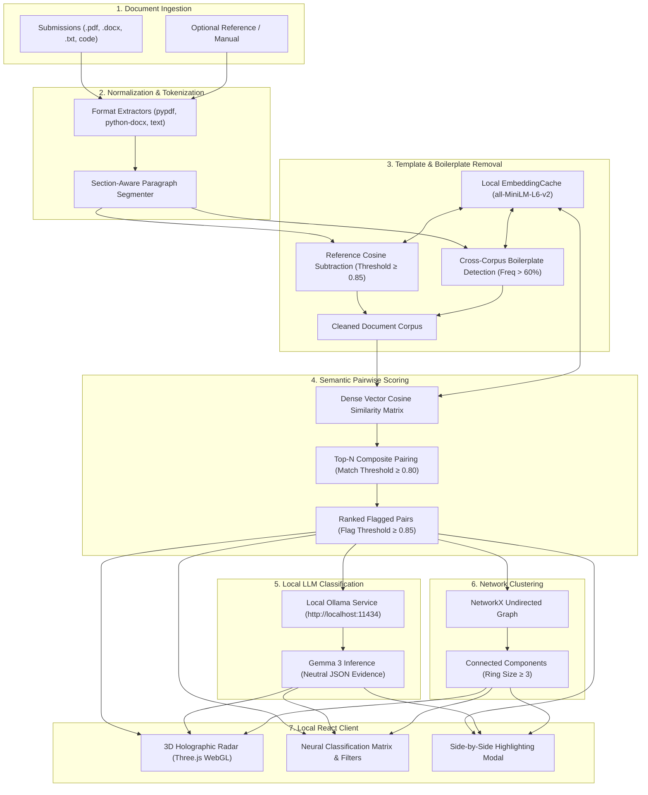

# Local Echo Scan

[](https://opensource.org/licenses/MIT)
[](README.md)
[](https://www.python.org/)
[](https://react.dev/)

> **A local-first, privacy-preserving semantic similarity and collusion detection engine.**
>
> *Process academic submissions, technical reports, and structured assignments 100% offline — zero data egress, zero cloud dependencies.*

---

## Overview

Traditional similarity checkers struggle with structured documents (lab reports, problem sets, and templated assignments) because shared instructions, questions, and boilerplate trigger massive false-positive similarity rates ($60\%–90\%$). Furthermore, cloud-based plagiarism checkers risk violating data privacy regulations (e.g., FERPA, GDPR) by transmitting student work to remote third-party servers.

**Local Echo Scan** solves this using an air-gapped, modular pipeline:
1. **Template & Boilerplate Stripping**: Automatically detects and strips shared assignment prompts or lab manuals.
2. **Dense Vector Embeddings**: Computes pairwise semantic paragraph similarity using compact transformer models running locally on CPU/GPU.
3. **Local LLM Synthesis (Gemma 3 via Ollama)**: Neutral, air-gapped qualitative classifications (`likely copy`, `paraphrase`, `shared source`, `coincidence`).
4. **Graph-Based Collusion Rings**: Employs graph algorithms to expose multi-author collaboration clusters.
5. **Interactive 3D Holographic Visualizer**: Explores document submission topologies and similarity links via WebGL.

---

## System Architecture



---

## Key Features

- **🧹 Template & Boilerplate Elimination**:
  - **Reference Manual Subtraction**: Eliminates shared experiment guidelines, problem statements, or assignment briefs.
  - **Cross-Corpus Frequency Filter**: Automatically flags and excludes near-identical passages ($\cos \theta \ge 0.90$) appearing across $>60\%$ of submissions.

- **📐 Dense Vector Embeddings & Paragraph Ranking**:
  - Uses `sentence-transformers` (`all-MiniLM-L6-v2`) cached in local memory.
  - Scores documents based on localized maximum paragraph alignment rather than global document length, catching targeted copy-pasting.

- **🤖 Air-Gapped LLM Explanations (Gemma 3)**:
  - Communicates with a local [Ollama](https://ollama.com/) instance hosting Google's `gemma3`.
  - Classifies matching segments into objective categories: `likely copy`, `paraphrase`, `shared source`, or `coincidence`, alongside concise evidence rationales.
  - Operates with non-blocking fallbacks: if Ollama is unreachable, semantic scoring completes without interruption.

- **🕸️ Graph Clustering for Collusion Rings**:
  - Builds an undirected graph $G = (V, E)$ where nodes represent authors and edges represent flagged similarities.
  - Isolates connected components of size $\ge 3$ to uncover multi-student sharing rings.

- **🌐 Interactive 3D Spatial Radar (Three.js)**:
  - Renders an interactive 3D WebGL network graph of all submissions.
  - Color-codes dynamic laser beams according to Gemma AI classifications (Crimson for direct copy, Amber for paraphrase).

- **🔍 Side-by-Side Passage Diffing**:
  - Dual-column inspector with sentence-level overlap and semantic highlight overlays.

- **⚖️ Evidence-Not-Verdict Design**:
  - Built strictly as an evidence-gathering aid for human evaluation. Academic integrity judgment remains exclusively with the evaluator.

---

## Project Structure

```
Local-Echo-Scan/
├── backend/
│   ├── app/
│   │   ├── main.py           # FastAPI endpoints (/analyze, /explain-pairs, /health)
│   │   ├── parsing.py        # PDF, DOCX, TXT parsers & regex segmenters
│   │   ├── template.py       # Boilerplate frequency detector & reference subtraction
│   │   ├── similarity.py     # Dense vector cosine similarity & composite ranking
│   │   ├── explain.py        # Local Ollama / Gemma 3 integration
│   │   ├── rings.py          # NetworkX connected-components clustering
│   │   └── models.py         # Pydantic schemas & dataclasses
│   └── tests/                # Comprehensive unit test suite (100% offline)
├── frontend/
│   ├── src/
│   │   ├── components/
│   │   │   └── Echo3DVisualizer.jsx  # Three.js 3D spatial holographic radar
│   │   ├── App.jsx           # Main React application & dual-mode dashboard
│   │   ├── App.css           # Glassmorphism cyber-slate stylesheet
│   │   └── main.jsx          # React DOM entry point
│   └── package.json          # Vite + React setup
├── sample_data/
│   ├── generate.py           # Synthetic dataset generator (15 submissions + manual)
│   ├── ANSWER_KEY.md         # Planted copy test cases reference
│   └── output/               # Pre-generated test submissions (.txt and .docx)
├── run_sample.py             # CLI runner for end-to-end terminal analysis
├── requirements.txt          # Python dependencies
├── LICENSE                   # MIT License
└── README.md
```

---

## Quickstart

### 1. Prerequisites
- **Python 3.9+**
- **Node.js 18+**
- *(Optional for AI explanations)* **Ollama** with `gemma3`

### 2. Backend Setup
```bash
# Clone the repository
git clone https://github.com/your-username/Local-Echo-Scan.git
cd Local-Echo-Scan

# Create virtual environment & install dependencies
python3 -m venv venv
source venv/bin/activate    # On Windows: venv\Scripts\activate
pip install -r requirements.txt
```

> **First Run Note**: `sentence-transformers` automatically caches `all-MiniLM-L6-v2` (~90 MB) locally on the first run. Subsequent runs execute 100% offline.

### 3. Local LLM Setup (Optional)
```bash
# Pull and start Gemma 3 in Ollama
ollama pull gemma3
```

### 4. Frontend Setup
```bash
cd frontend
npm install
cd ..
```

---

## Running the Application

### Option 1: Web Interface (Recommended)

1. **Start the FastAPI backend**:
   ```bash
   uvicorn backend.app.main:app --host 0.0.0.0 --port 8000 --reload
   ```

2. **Start the Vite frontend**:
   ```bash
   cd frontend
   npm run dev
   ```

3. Open **`http://localhost:5173`** in your browser.
   - Use the **⚡ Instant 15-Student Ohm's Law Demo** button for an immediate 1-click test.
   - Or drag-and-drop any folder of student submissions and an optional lab manual.

### Option 2: Headless CLI Runner

Run the end-to-end pipeline directly in your terminal on sample submissions:
```bash
python3 run_sample.py
```

---

## Test Suite

Run all backend unit test suites (parsing, boilerplate filtering, vector similarity, Gemma parsing, and graph rings):
```bash
python3 backend/tests/test_parsing.py && \
python3 backend/tests/test_template.py && \
python3 backend/tests/test_similarity.py && \
python3 backend/tests/test_explain.py && \
python3 backend/tests/test_rings.py
```

---

## Limitations & Best Practices

1. **Similarity Is Evidence, Not Proof**: High semantic similarity indicates overlapping data, phrasing, or derivations. It does not establish intent. Shared lab partners, common textbook formulas, or standardized formats can produce elevated scores.
2. **Threshold Calibration**:
   - Default **Match Threshold**: `0.80` (paragraph-level).
   - Default **Flag Threshold**: `0.85` (document-level composite).
   - Adjust sliders in the UI based on assignment specificity.
3. **Advisory LLM Outputs**: Gemma 3 classifications are advisory aids intended to assist manual review prioritization.

---

## Tech Stack & Credits

| Layer | Technology | Role |
| :--- | :--- | :--- |
| **Backend API** | [FastAPI](https://fastapi.tiangolo.com/) | High-concurrency async REST service |
| **Embeddings** | [sentence-transformers](https://www.sbert.net/) | Dense vector representations (`all-MiniLM-L6-v2`) |
| **Local LLM** | [Ollama](https://ollama.com/) & [Gemma 3](https://ai.google.dev/gemma) | Air-gapped qualitative passage evaluation |
| **Graph Engine** | [NetworkX](https://networkx.org/) | Graph modeling & connected component discovery |
| **Document Parsers** | [pypdf](https://pypdf.readthedocs.io/) & [python-docx](https://python-docx.readthedocs.io/) | Multi-format text extraction |
| **Frontend** | [React](https://react.dev/) & [Vite](https://vitejs.dev/) | Reactive dashboard |
| **3D Graphics** | [Three.js](https://threejs.org/) | WebGL spatial holographic submission radar |

## License

This project is licensed under the [MIT License](LICENSE).
